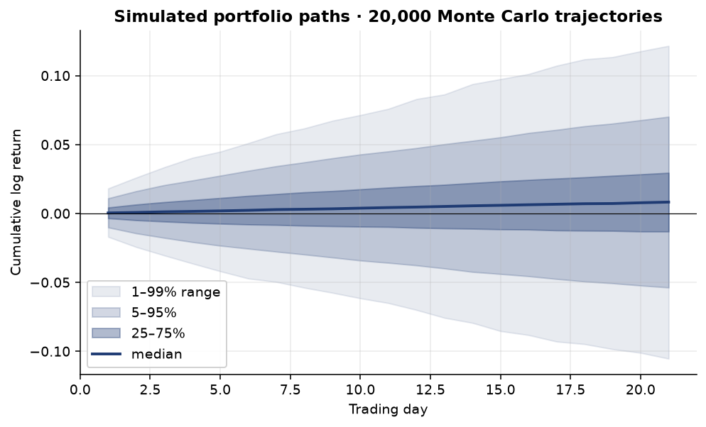
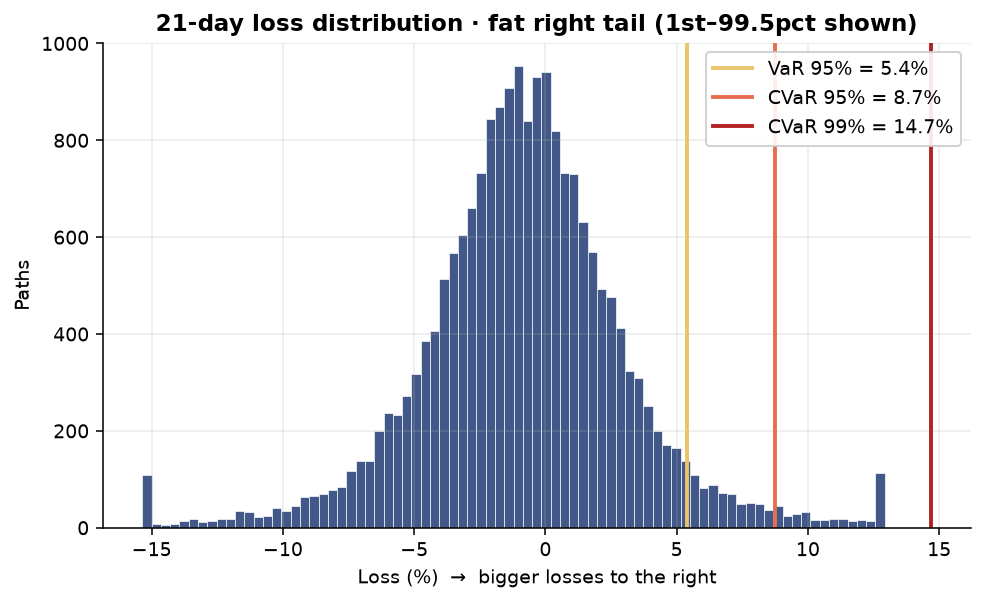
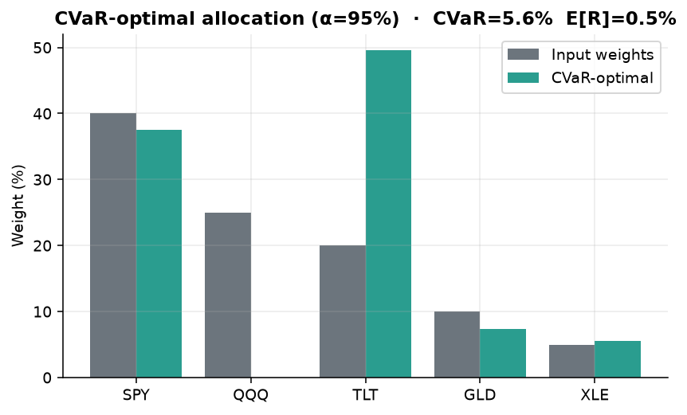
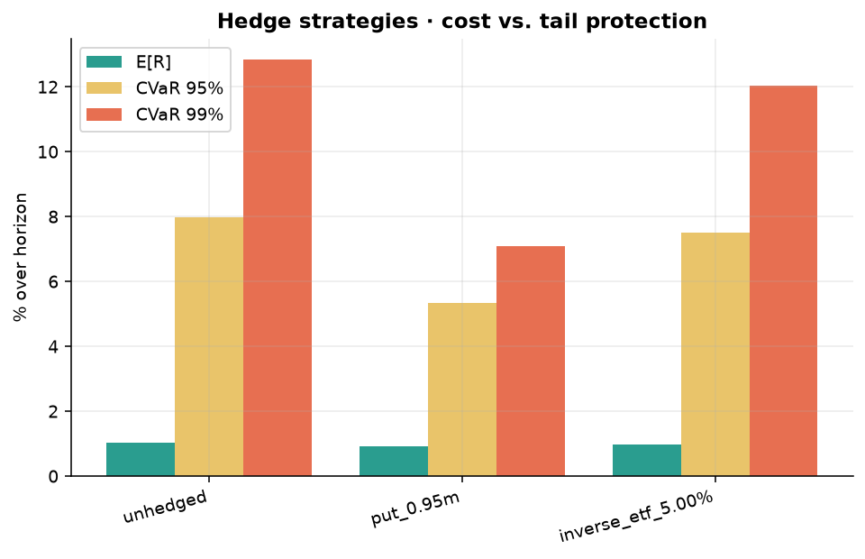
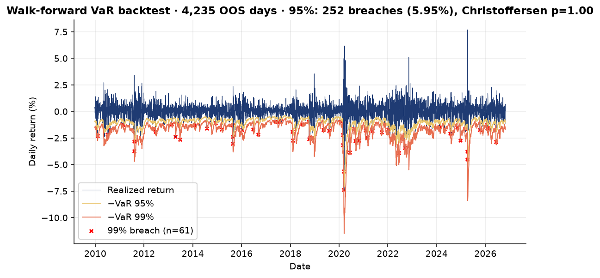

# Tail Risk Scenario Engine

> **A research-grade Monte Carlo engine for measuring, optimizing, and hedging
> the *extreme downside* of equity portfolios.**
> Fat-tailed marginals, GARCH volatility clustering, regime switching,
> tail-dependent copulas, CVaR optimization, hedge simulation, walk-forward
> backtests, and a natural-language scenario interpreter — all wired into a
> Streamlit dashboard.

<p align="center">
  
  
</p>

---

## Why this exists

Mean-variance optimization assumes returns are Gaussian and correlations are
stable. Both assumptions break exactly when they matter most — in a crisis. This
engine is a deliberate, layered answer to those failure modes:

| Failure mode of standard models      | What this engine does instead                                  |
|---|---|
| Gaussian tails → underestimates extreme losses | Student-t marginals (+ optional GPD peaks-over-threshold) |
| Constant volatility                   | Per-path GARCH(1,1)-t with explosive-path clipping             |
| One-regime world                      | 2-state Markov-switching (normal vs. crisis), fit on history   |
| Linear correlation                    | Student-t copula with **regime-conditional** dependence        |
| Mean-variance only                    | CVaR optimization (Rockafellar–Uryasev LP via cvxpy)           |
| "Trust the model" without validation  | Walk-forward backtest with Kupiec & Christoffersen tests       |

---

## Highlights

### 1 · Fat-tailed Monte Carlo with regime switching
20,000 paths over a 21-day horizon, fit on SPY/QQQ/TLT/GLD/XLE daily data since
2007. The simulated 21-day distribution matches the historical one where it
matters: VaR 95% 5.4% (history 5.0%), CVaR 99% 14.2% (history 16.1%), excess
kurtosis ~7-11 (history 7.6). Without the crisis regime the deep tail is far too
thin (CVaR 99% ~10%).

<p align="center">
  
</p>

### 2 · CVaR-optimal portfolios shift toward genuine diversifiers
Given the same fitted model, the CVaR optimizer moves weight out of equity-beta
and into Treasuries — a sensible response to fat tails that mean-variance
under-emphasizes.

<p align="center">
  
</p>

### 3 · Hedge strategies are scored on cost vs. tail protection
Every hedge variant is run through the same simulated paths so trade-offs are
honest. Puts are priced with Black-Scholes at the current VIX, so their cost
moves with the market. At VIX 17.7%, a 1-month 5% out-of-the-money SPY put on
the whole portfolio cut CVaR 99% from 12.5% to 7.0% for 0.11% of expected
return; a 5% inverse-ETF sleeve barely touched it (11.7%).

<p align="center">
  
</p>

### 4 · Walk-forward validation with regulatory coverage tests
**The full engine at its own horizon** (`tailrisk validate`): at each of 177
non-overlapping 21-day windows since 2012, every model is refit on data up to
that date only, 2,000 paths are simulated, and the predicted VaR is compared
with the realized portfolio return.

|                | breaches | expected | Kupiec p | Christoffersen p |
|----------------|----------|----------|----------|------------------|
| 21-day VaR 95% | 5        | 8.9      | 0.15 ✓   | 0.59 ✓           |
| 21-day VaR 99% | 0        | 1.8      | 0.06 ✓   | 1.00 ✓           |

Predicted risk tracks realized risk (rank correlation of predicted CVaR 95% with
realized |return|: +0.36). The engine leans conservative: 5 breaches where 8.9
were expected.

**A 1-day stand-in** (`tailrisk backtest`): one GARCH(1,1)-t on the portfolio
series, refit every 63 days, 1-day VaR on 4,235 out-of-sample days:

|                | breach rate | nominal | Kupiec p | Christoffersen p |
|----------------|-------------|---------|----------|------------------|
| 95% VaR        | 5.95%       | 5.00%   | 0.006 ✗  | 1.00 ✓           |
| 99% VaR        | 1.44%       | 1.00%   | 0.007 ✗  | 0.013 ✗          |

At one day the simple model is slightly too thin-tailed, and its 99% breaches
cluster: bad days come in runs it doesn't anticipate.

<p align="center">
  
</p>

### 5 · Natural-language scenario queries
The dashboard accepts plain English and routes it through a small interpreter
into the simulation engine:

> *"What is my loss if 2008 repeats?"* → historical replay, **CVaR 95% = 23.0%**
> *"What if volatility doubles?"*     → vol multiplier 2× (plus a drift and correlation shock), **CVaR 95% = 26.4%**

The same scenarios run from the CLI with `tailrisk stress`.

---

## Architecture

```
src/tailrisk/
├── data/          Yahoo Finance loader + log-return computation
├── models/        Distributions (t, GPD), GARCH, regime, copula — each isolated
├── simulation/    MonteCarloEngine composes the fitted models into paths
├── risk/          VaR, CVaR, drawdown, attribution
├── optimization/  CVaR LP optimizer (Rockafellar–Uryasev)
├── hedging/       Put / inverse-ETF payoff models + comparison
├── stress/        Named historical scenarios + parametric shocks
├── backtest/      Walk-forward GARCH + Kupiec & Christoffersen tests
├── viz/           Plotly figures (fan chart, loss dist, hedge, backtest)
├── llm/           NL → ScenarioRequest interpreter
└── cli.py         `tailrisk` CLI (typer)
app/streamlit_app.py    Interactive dashboard
configs/                Default + stress-scenario YAMLs
tests/                  31-test pytest suite
```

The design intent is **composability over monolith**: each statistical concern
is its own module with a `Fit` dataclass, and `fit_models()` snaps them
together. Swapping the t-copula for a vine copula, or adding a third regime,
touches one file.

---

## Quickstart

```powershell
python -m venv .venv
.\.venv\Scripts\Activate.ps1
pip install -e ".[app,dev]"

# CLI
tailrisk simulate --config configs/default.yaml
tailrisk optimize --config configs/default.yaml
tailrisk hedge    --config configs/default.yaml
tailrisk stress   --config configs/default.yaml
tailrisk backtest --config configs/default.yaml --min-train 750
tailrisk validate --config configs/default.yaml   # full-engine walk-forward, ~5 min

# Dashboard
streamlit run app/streamlit_app.py

# Regenerate the README figures
python scripts/generate_readme_figures.py
```

---

## Engineering notes

A few choices worth flagging for anyone reading the code:

- **Per-path GARCH state.** `(h_prev, eps_prev)` are tracked per path with
  shape `(n_paths, n_assets)`, so each trajectory gets its own conditional
  volatility evolution — without this, tail spread is dramatically under-stated.
  Innovations are clipped at a configurable z-score to prevent the rare
  α + β ≈ 0.99 + heavy-tailed shock combo from exploding numerically.
- **Regime-conditional copula.** Historical days are classified by the
  smoothed regime probabilities; if both regimes have enough observations a
  separate copula is fit per regime. At simulation time, the path's current
  regime selects which copula draws the dependence shock.
- **Marginals and copulas are fitted on GARCH-standardized residuals.** Raw
  returns are fat-tailed *because* of volatility clustering, which GARCH already
  models; fitting the marginals on them counted the tails twice (SPY's raw-return
  Student-t has df ~2.4, i.e. infinite kurtosis, and simulated kurtosis swung
  between ~20 and ~120 from seed to seed).
- **Regimes start from today.** Each path's regime chain starts from today's
  estimated regime probabilities, not the long-run mix (which put ~20% of paths
  in crisis on day one). The crisis volatility boost is relative to today's
  regime: on a crisis day GARCH vol is already high, and stacking the full
  crisis/calm ratio on it gave crisis-start months a 95% VaR ~4.5x realized vol.
- **Drift is the sample mean.** The GARCH-t fit's `mu` is a robust location
  estimate near the median, ~2.5x the mean for skewed equity returns.
- **Hedges are scored in simple returns.** A put's payoff is money; adding it to a
  log portfolio return overstates crash losses past the strike.
- **Mean is added once.** Student-t marginals carry their own location
  parameter, so the engine subtracts `loc` before applying GARCH-scaled shocks
  to avoid double-counting drift — a subtle bug that quadrupled expected
  returns in an earlier draft.
- **Two backtests.** `validate` refits the full engine at every test date (slow,
  ~5 minutes); `backtest` uses one portfolio-level GARCH for 1-day VaR (fast).
  The 1-day backtest's recursion between refits is checked against `arch`'s own
  filter in the tests.
- **`statsmodels` quirk.** Markov regression returns a column-stochastic
  transition matrix — the engine transposes and renormalizes so each row sums
  to 1.

---

## Roadmap

- [ ] Vine copulas for higher-dimensional tail dependence
- [ ] Real LLM backend behind the NL interpreter (currently a typed-pattern stub)
- [ ] On-disk cache for `yfinance` so runs are reproducible offline
- [ ] Expected Shortfall backtest (Acerbi–Székely Z-tests)
- [x] Multi-day VaR backtest (`tailrisk validate`, 21 days)

---

## References

- Rockafellar & Uryasev (2000), *Optimization of Conditional Value-at-Risk*.
- McNeil, Frey & Embrechts, *Quantitative Risk Management* (Princeton, 2015).
- Hamilton (1989), *A New Approach to the Economic Analysis of Nonstationary
  Time Series and the Business Cycle*, Econometrica.
- Engle (1982), Bollerslev (1986) on (G)ARCH.
- Christoffersen (1998), *Evaluating Interval Forecasts*, IER.
- Kupiec (1995), *Techniques for Verifying the Accuracy of Risk Measurement
  Models*.

---

*Built as a portfolio piece on quantitative risk modeling — equal parts
statistics, software architecture, and honest validation.*
